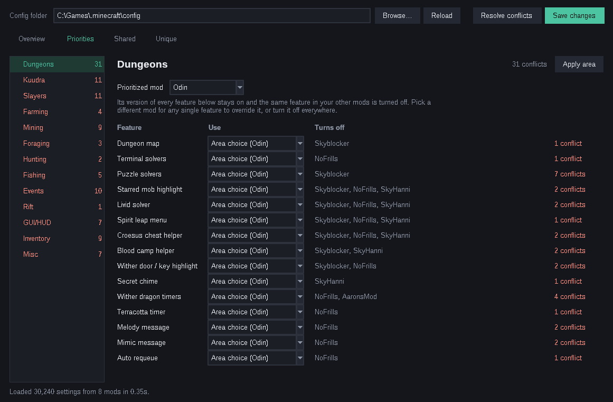

# SkyBlock Config Manager

Running several Fabric SkyBlock mods at once usually means some features run twice: two dungeon maps, three Diana guessers, pest finders from several mods. SkyBlock Config Manager reads your mods' config files, finds the features that more than one of them provides, and switches each one on in only the mod you choose.



- **Knows 83 features that several mods provide**, in 13 areas from Dungeons and Kuudra to Diana and the HUD.
- **You decide which mod does what:** pick a mod for each area, override any single feature, or switch a feature off in every mod.
- **Nothing changes until you've reviewed it:** every switch it would flip is listed with its current and recommended value.
- **Safe saving:** configs are backed up before they're saved, and a file the game changed after loading is never overwritten.
- **Search and edit any setting** of the supported mods, not only the overlapping ones.
- **Shows which version of each mod you have installed** and checks Modrinth for newer builds.
- **Portable:** a single .exe for Windows, or one Python file for any system.

## Download

**Windows:** get `SkyBlockConfigManager.exe` from the [latest release](../../releases/latest). It's a single file for 64-bit Windows 10 or 11, with nothing to install. The exe isn't code-signed, so the first time you run it Windows may show "Windows protected your PC": click **More info**, then **Run anyway**.

**macOS, Linux, or Windows with Python:** download `skyblock_config_manager.py` and run it with Python 3.8 or newer. It only uses the standard library.

```
python3 skyblock_config_manager.py
```

On Windows the command is `py skyblock_config_manager.py`. On Linux you may need to install Tkinter first (`sudo apt install python3-tk` on Debian and Ubuntu).

## Supported mods

| Mod | Config it reads, inside `.minecraft/config` | Overlapping features |
|---|---|---:|
| [NoFrills](https://modrinth.com/mod/nofrills) | `NoFrills/Configuration.json` | 48 |
| [SkyHanni](https://modrinth.com/mod/skyhanni) | `skyhanni/config.json` | 41 |
| [Skyblocker](https://modrinth.com/mod/skyblocker-liap) | `skyblocker.json` | 49 |
| [Aaron's Mod](https://modrinth.com/mod/aaron-mod) | `aaron-mod.json` | 5 |
| [SkyblockAddons](https://modrinth.com/mod/skyblockaddons-unofficial) | `skyblockaddons/configurations.json` | settings only |
| [SkyOcean](https://modrinth.com/mod/skyocean) | `skyocean/config.jsonc` | 15 |
| [Firmament](https://modrinth.com/mod/firmament) | `firmament/` (one file per feature) | 4 |
| [Odin](https://modrinth.com/mod/odin) | `odin/odin-config.json` | 29 |
| [Skyblock Overhaul (SBO)](https://modrinth.com/mod/skyblock-overhaul) | `SBO/config.jsonc` | 8 |

The settings were read from each mod's Fabric build for Minecraft 26.1.2. A mod only takes part when its config is found, and a feature is only compared when at least two of your mods offer it. SkyblockAddons settings can be browsed and edited, but no overlapping features are defined for it yet.

| Area | Features | For example |
|---|---:|---|
| Dungeons | 15 | Dungeon map, Terminal solvers, Puzzle solvers, Starred mob highlight, … |
| Kuudra | 7 | Supply waypoints, Pearl waypoints, Ballista build helper, Kuudra highlight, … |
| Slayers | 9 | Boss spawn alert, Miniboss spawn alert, Boss highlight, Miniboss highlight, … |
| Farming | 3 | Pest finder, Visitor helper, Glowing mushrooms |
| Mining | 9 | Metal detector solver, Fossil solver, Corpse finder, Corpse profit tracker, … |
| Foraging | 2 | Moonglade beacon solver, Mute phantoms |
| Hunting | 3 | Shard tracker, Lasso alert, Invisibug highlight |
| Fishing | 4 | Bobber timer, Hide other players' bobbers, Lava replacement, Fishing hook display |
| Events | 10 | Diana burrow guess, Diana arrow guess, Nearby burrow detection, Nearest warp hint, … |
| Rift | 1 | Enigma soul waypoints |
| GUI/HUD | 6 | Custom tab list, TPS display, Health / mana bars, Item ability cooldowns, … |
| Inventory | 6 | Inventory buttons, Keep cursor position, Anvil helper, Experiment solvers, … |
| Misc | 8 | Etherwarp overlay, Auto sprint, Wardrobe keybinds, Loadout keybinds, … |

## How to use it

1. **Close Minecraft.** The game writes its configs when it exits, which would undo your changes.
2. **Open the app.** It finds your `config` folder by itself: the one you used last time, one next to the app or in the folder it was started from, or the default `.minecraft` location. If it can't, choose the folder with **Browse…**
3. **Overview** lists each mod it found, how many of its settings overlap with other mods, and how many of its settings disagree with your choices. **Check for updates** compares the jars in your `mods` folder with the newest Fabric builds on Modrinth.
4. **Priorities:** for each area, choose the **Prioritized mod**. Its version of every feature in that area stays on, and the same feature is turned off in your other mods. To make an exception, pick another mod, or **Off in every mod**, in a feature's **Use** column. If the prioritized mod doesn't offer a feature, the first mod listed for it keeps it.
5. **Shared** lists every overlapping switch with its current and recommended value, with conflicts highlighted. **Unique** lists all the other settings. In both you can search, filter and edit: double-click a true/false setting to flip it, or any other setting to type a new value.
6. **Resolve conflicts** applies every recommended value, and **Apply area** applies one area's. Nothing is written to disk yet.
7. **Save changes** (Ctrl+S) writes the changed files. Then start Minecraft.

Your choices for each area and feature are remembered for next time.

## Keeping your configs safe

- The first time a config file is saved after loading, a copy of the original is kept next to it as `<name>.bak_<date>_<time>`. To undo the changes, delete the file and rename the backup.
- It won't save over a file that changed on disk after it was loaded, which usually means the game was running. Close the game, click **Reload**, and make the change again.
- Comments in `.jsonc` files can't be kept when saving, so it tells you which files have them and asks first.
- Files are written through a temporary file, so a crash can't leave a half-written config. Each file keeps its indentation, and files written on a single line stay on a single line.
- Reloading or closing with unsaved changes asks first.

## Where the app keeps its own settings

It remembers your config folder and your choices for each area and feature:

- The `.exe` keeps them in `skyblock_config_manager.settings.json` next to itself, so you can move it around with its settings. If it can't write there (for example in Program Files), it uses your user folder instead.
- The Python script keeps them in `~/.skyblock_config_manager.json`.

## Adapting it to your pack

Everything the app compares is defined in tables at the top of `skyblock_config_manager.py`:

- **`MODS`**: where each mod keeps its config (a list of files, first one found wins, or a folder of files), its mod id, used to find its jar, and its Modrinth project, used by **Check for updates**.
- **`AREAS`**: the areas shown in the Priorities tab, in order.
- **`FEATURES`**: one entry for each feature that several mods provide, with each mod's on/off switch:

  ```python
  ("Events", "Diana burrow guess", {
      "SBO": "*spadeGuess",
      "SkyHanni": "event.diana.guess",
      "Skyblocker": "helpers.mythologicalRitual.enableMythologicalRitualHelper",
      "Firmament": "diana.ancestral-spade",
      "NoFrills": "dianaSolver.enabled"}),
  ```

  A switch is a dotted config key. A list of keys means several switches that turn on and off together. A key starting with `*` matches by its ending, for mods that nest their settings differently between versions: `*spadeGuess` matches both `spadeGuess` and `burrows.spadeGuess`. `None` means the mod has the feature but no single switch for it; it still takes part. Order matters: an area's default mod is the first one listed for it.
- **`PREFERRED`**: settings to keep at a fixed value even though no other mod overlaps them.
- **`LABELS`**: display names for settings whose generated name isn't right.

`GAME_VERSION` and `LOADER` set which builds **Check for updates** looks for. The .exe has all of this built in, so rebuild it after editing the tables.

## Building the .exe

On Windows, double-click `packaging\build_exe.bat`. It installs PyInstaller and builds `dist\SkyBlockConfigManager.exe` from `packaging\SkyBlockConfigManager.spec`. Building needs Python 3.8 or newer; the finished exe doesn't.

## Publishing a release

GitHub Actions builds release copies on Windows (`.github/workflows/release.yml`):

1. Set `__version__` in `skyblock_config_manager.py` (for example `3.2.0`) and merge the change into `main`.
2. On GitHub, open **Releases → Draft a new release**, create the tag `v3.2.0` on `main` and publish it. Pushing the tag with git works too.

Within a few minutes the workflow builds the exe, checks that it starts and loads a config folder, and attaches the `.exe` and `.zip` to the release. If you left the release description empty, it fills that in as well. If the tag doesn't match `__version__`, nothing is published. Pull requests that change the app get the same build and check.

## Troubleshooting

- **A mod shows "not found" on the Overview tab:** its config isn't where `MODS` expects it. Check that you opened the right `config` folder, or add the file's location to `MODS`.
- **Every mod shows "not installed":** installed versions are read from the jars in the `mods` folder next to your `config` folder.
- **"It was changed on disk after loading":** the game, or another program, rewrote the file after the app loaded it. Close the game, click **Reload**, and make the change again.
- **`No module named 'tkinter'` (Linux):** install Tkinter, for example with `sudo apt install python3-tk`.
